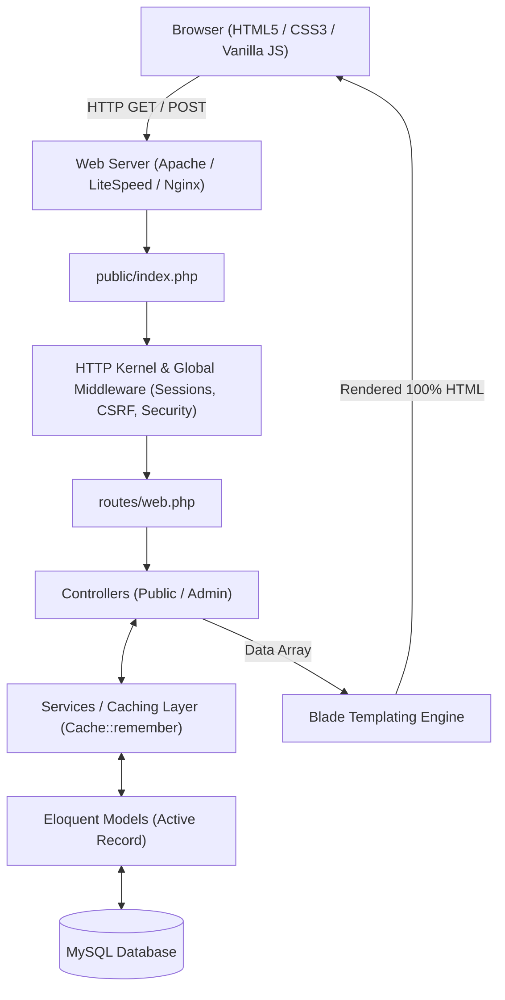

# Application Architecture: Laravel 11, Blade, MySQL & Vanilla JS

## 1. Architectural Philosophy: Server-Rendered Simplicity



---

## 2. Request Lifecycle & Caching Strategy

### A. Public Page Request (e.g. `GET /tours`)
1. User requests `/tours?category=inbound&duration=7-days`.
2. Laravel boots in milliseconds, parses session cookies, and processes route middleware.
3. `Public\TourController@index` is invoked:
   - For public static views (Home, About, Destinations), cached queries (`Cache::remember('home_featured_tours', 3600, ...)`) ensure subsequent page loads execute in < 20ms without hitting MySQL.
   - For filtered/paginated queries, Eloquent runs parameterized, indexed SQL queries with eager loading (`with(['category', 'destination'])`) preventing N+1 query performance hits.
4. The controller passes data into a Blade view:
   ```php
   return view('pages.public.tours.index', [
       'tours' => $tours,
       'categories' => $categories,
       'destinations' => $destinations,
       'selectedCategory' => $request->category,
   ]);
   ```
5. Blade compiles the template and components (`layouts/public.blade.php`, `components/tour-card.blade.php`) into clean HTML and sends it as the HTTP response.
6. The browser parses the HTML immediately. Interactive elements (like mobile menu drawers, search overlays, and booking date pickers) are handled by vanilla JavaScript without needing a multi-megabyte JavaScript framework.

### B. Form Submission (e.g. `POST /bookings` or `POST /contact`)
1. User fills out the booking or contact form and submits via standard HTTP POST.
2. Laravel's `VerifyCsrfToken` middleware verifies the `@csrf` token automatically.
3. Dedicated **Form Requests** (`BookingStoreRequest`, `ContactStoreRequest`) validate input on the server (names, email formats, valid departure dates, required fields).
4. **If validation fails**: Laravel redirects back with error messages and old input (`back()->withErrors($validator)->withInput()`). Blade displays inline error messages effortlessly via `@error('field') <span class="text-danger">{{ $message }}</span> @enderror`.
5. **If validation passes**: The controller stores the booking/message in MySQL, dispatches email notifications (if configured), and redirects back with a success banner (`with('success', 'Thank you! Your inquiry has been received.')`).

### C. Cache Invalidation Flow
When an administrator creates, edits, or deletes a tour or destination in the admin dashboard:
- Eloquent model events or controller hooks call `Cache::forget('home_featured_tours')`, `Cache::forget('active_categories')`, etc.
- The next visitor immediately receives fresh data from MySQL, ensuring cache freshness without manual server restarts.

---

## 3. SEO & Structured Data Implementation

Unlike SPAs where search crawlers might not execute JavaScript or wait for client hydration:
- Every public Blade page extends a shared master layout that injects dynamic `<title>`, `<meta name="description">`, Open Graph (`og:title`, `og:image`, `og:url`), and Twitter Cards.
- Every tour details page emits **JSON-LD Schema (`TouristTrip` / `Product`)** in the `<head>`:
  ```html
  <script type="application/ld+json">
  {
    "@context": "https://schema.org",
    "@type": "TouristTrip",
    "name": "{{ $tour->title }}",
    "description": "{{ Str::limit(strip_tags($tour->overview), 160) }}",
    "touristType": "{{ $tour->category->name ?? 'General' }}",
    "offers": {
      "@type": "Offer",
      "price": "{{ $tour->starting_price }}",
      "priceCurrency": "BDT"
    }
  }
  </script>
  ```
- Dynamic `sitemap.xml` automatically includes all published tours, destinations, and static pages with `lastmod` timestamps.

---

## 4. Administrative Security Architecture

- **Session-Based Authentication**: Standard Laravel session cookies (`HttpOnly`, `SameSite=Lax`, encrypted).
- **Protected Routes**: All `/admin/*` routes are gated by `auth` middleware. Guests attempting to access `/admin` are redirected to `/login`.
- **Authorization**: Admin users have verified credentials; unauthorized requests are rejected with HTTP 403.
- **CSRF Defense**: All state-modifying actions (`POST`, `PUT`, `DELETE`) require a valid `@csrf` token.
- **File Upload Security**: Uploaded tour images are validated for allowed MIME types (`jpeg`, `jpg`, `png`, `webp`), size limits (max 4MB), and given cryptographically safe randomized filenames before storage in `storage/app/public/`.
