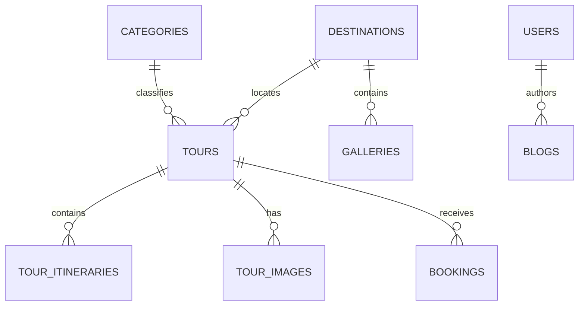

# Database Schema & Data Models: MySQL

## 1. Schema Entity Relationship Overview



---

## 2. Table Specifications & Columns

### Table 1: `users`
Stores system administrators and staff accounts.
- `id` (BIGINT UNSIGNED, Primary Key, Auto Increment)
- `name` (VARCHAR(191), Not Null)
- `email` (VARCHAR(191), Unique, Not Null)
- `password` (VARCHAR(191), Not Null) - Bcrypt hashed
- `role` (ENUM('admin', 'editor'), Default: 'admin')
- `remember_token` (VARCHAR(100), Nullable)
- `created_at` / `updated_at` (TIMESTAMP)

### Table 2: `categories`
Organizes tours into classifications (e.g., Inbound, Outbound, Domestic, Specialized, Bird Watching, Trekking, Photography, Festival, Ancestral, Family).
- `id` (BIGINT UNSIGNED, Primary Key, Auto Increment)
- `name` (VARCHAR(100), Not Null)
- `slug` (VARCHAR(120), Unique, Not Null, Index)
- `icon` (VARCHAR(191), Nullable) - e.g. `cat-trekking.webp`
- `description` (TEXT, Nullable)
- `sort_order` (INT, Default: 0)
- `is_active` (BOOLEAN, Default: TRUE)
- `created_at` / `updated_at` (TIMESTAMP)

### Table 3: `destinations`
Geographic regions showcased on the site (e.g., Sundarbans, Srimangal, Kaptai Lake, Cox's Bazar, Bandarban, Japan, Singapore).
- `id` (BIGINT UNSIGNED, Primary Key, Auto Increment)
- `name` (VARCHAR(150), Not Null)
- `slug` (VARCHAR(180), Unique, Not Null, Index)
- `country` (VARCHAR(100), Default: 'Bangladesh')
- `tagline` (VARCHAR(191), Nullable) - e.g. "Emerald Rolling Hills"
- `description` (LONGTEXT, Nullable)
- `banner_image` (VARCHAR(191), Nullable)
- `is_featured` (BOOLEAN, Default: FALSE)
- `created_at` / `updated_at` (TIMESTAMP)

### Table 4: `tours`
The core catalog item of Bongo Tanbo Travels.
- `id` (BIGINT UNSIGNED, Primary Key, Auto Increment)
- `category_id` (BIGINT UNSIGNED, Foreign Key -> `categories.id` ON DELETE SET NULL, Nullable)
- `destination_id` (BIGINT UNSIGNED, Foreign Key -> `destinations.id` ON DELETE SET NULL, Nullable)
- `title` (VARCHAR(255), Not Null)
- `slug` (VARCHAR(255), Unique, Not Null, Index)
- `duration_days` (INT, Not Null) - e.g. 7
- `duration_nights` (INT, Nullable) - e.g. 6
- `places_count` (INT, Default: 1) - e.g. 4
- `starting_price` (DECIMAL(10,2), Nullable)
- `currency` (VARCHAR(10), Default: 'BDT')
- `badge_text` (VARCHAR(100), Nullable) - e.g. "UNESCO Heritage", "Best Seller"
- `overview` (LONGTEXT, Nullable)
- `inclusions` (JSON, Nullable) - Array of strings e.g. `["AC Transport", "English Speaking Guide", "Hotel"]`
- `exclusions` (JSON, Nullable) - Array of strings e.g. `["Airfare", "Personal Expenses", "Tips"]`
- `difficulty` (ENUM('Easy', 'Moderate', 'Challenging'), Default: 'Easy')
- `featured_image` (VARCHAR(191), Nullable)
- `is_featured` (BOOLEAN, Default: FALSE, Index)
- `is_active` (BOOLEAN, Default: TRUE, Index)
- `created_at` / `updated_at` (TIMESTAMP)

### Table 5: `tour_itineraries`
Day-by-day detailed program for each tour package.
- `id` (BIGINT UNSIGNED, Primary Key, Auto Increment)
- `tour_id` (BIGINT UNSIGNED, Foreign Key -> `tours.id` ON DELETE CASCADE, Not Null)
- `day_number` (INT, Not Null)
- `title` (VARCHAR(255), Not Null) - e.g. "Day 1: Arrival & Dhaka City Heritage"
- `description` (TEXT, Not Null)
- `accommodation` (VARCHAR(191), Nullable)
- `meals` (VARCHAR(100), Nullable) - e.g. "Breakfast, Dinner"
- `created_at` / `updated_at` (TIMESTAMP)

### Table 6: `tour_images`
Multiple secondary photos for a tour gallery.
- `id` (BIGINT UNSIGNED, Primary Key, Auto Increment)
- `tour_id` (BIGINT UNSIGNED, Foreign Key -> `tours.id` ON DELETE CASCADE, Not Null)
- `image_path` (VARCHAR(191), Not Null)
- `caption` (VARCHAR(191), Nullable)
- `sort_order` (INT, Default: 0)
- `created_at` / `updated_at` (TIMESTAMP)

### Table 7: `bookings`
Inbound customer bookings and tailor-made travel inquiries.
- `id` (BIGINT UNSIGNED, Primary Key, Auto Increment)
- `tour_id` (BIGINT UNSIGNED, Foreign Key -> `tours.id` ON DELETE SET NULL, Nullable)
- `booking_reference` (VARCHAR(30), Unique, Not Null) - e.g. `BTB-2026-X89`
- `customer_name` (VARCHAR(150), Not Null)
- `customer_email` (VARCHAR(191), Not Null)
- `customer_phone` (VARCHAR(50), Not Null)
- `destination_interest` (VARCHAR(150), Nullable)
- `departure_date` (DATE, Nullable)
- `time_slot` (VARCHAR(50), Default: 'Flexible Schedule')
- `adults_count` (INT, Default: 1)
- `children_count` (INT, Default: 0)
- `special_requests` (TEXT, Nullable)
- `status` (ENUM('pending', 'contacted', 'confirmed', 'cancelled'), Default: 'pending', Index)
- `created_at` / `updated_at` (TIMESTAMP)

### Table 8: `contact_messages`
Submissions from the Contact Us page.
- `id` (BIGINT UNSIGNED, Primary Key, Auto Increment)
- `name` (VARCHAR(150), Not Null)
- `email` (VARCHAR(191), Not Null)
- `phone` (VARCHAR(50), Nullable)
- `subject` (VARCHAR(255), Nullable)
- `message` (TEXT, Not Null)
- `is_read` (BOOLEAN, Default: FALSE, Index)
- `created_at` / `updated_at` (TIMESTAMP)

### Table 9: `blogs`
Travel articles and destination guides.
- `id` (BIGINT UNSIGNED, Primary Key, Auto Increment)
- `user_id` (BIGINT UNSIGNED, Foreign Key -> `users.id` ON DELETE CASCADE, Not Null)
- `title` (VARCHAR(255), Not Null)
- `slug` (VARCHAR(255), Unique, Not Null, Index)
- `category` (VARCHAR(100), Default: 'Travel Guide')
- `featured_image` (VARCHAR(191), Nullable)
- `excerpt` (TEXT, Nullable)
- `content` (LONGTEXT, Not Null)
- `is_published` (BOOLEAN, Default: TRUE)
- `published_at` (TIMESTAMP, Nullable)
- `created_at` / `updated_at` (TIMESTAMP)

### Table 10: `galleries`
Archive photos for the gallery showcase.
- `id` (BIGINT UNSIGNED, Primary Key, Auto Increment)
- `destination_id` (BIGINT UNSIGNED, Foreign Key -> `destinations.id` ON DELETE SET NULL, Nullable)
- `title` (VARCHAR(191), Not Null)
- `image_path` (VARCHAR(191), Not Null)
- `tag` (VARCHAR(100), Nullable) - e.g. "Waterfalls", "Beaches", "Culture"
- `created_at` / `updated_at` (TIMESTAMP)

### Table 11: `site_settings`
Configurable business settings (contact phones, addresses, social links).
- `id` (BIGINT UNSIGNED, Primary Key, Auto Increment)
- `key` (VARCHAR(100), Unique, Not Null)
- `value` (TEXT, Nullable)
- `created_at` / `updated_at` (TIMESTAMP)

---

## 3. Eloquent Model Relationships

```php
// Category.php
public function tours() {
    return $this->hasMany(Tour::class);
}

// Destination.php
public function tours() {
    return $this->hasMany(Tour::class);
}
public function galleries() {
    return $this->hasMany(Gallery::class);
}

// Tour.php
public function category() {
    return $this->belongsTo(Category::class);
}
public function destination() {
    return $this->belongsTo(Destination::class);
}
public function itineraries() {
    return $this->hasMany(TourItinerary::class)->orderBy('day_number');
}
public function images() {
    return $this->hasMany(TourImage::class)->orderBy('sort_order');
}
public function bookings() {
    return $this->hasMany(Booking::class);
}

// Booking.php
public function tour() {
    return $this->belongsTo(Tour::class);
}
```
